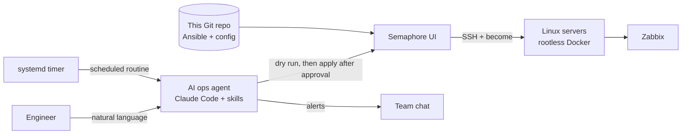

# devopsproject

In this repository, you'll find examples of my work with Claude Code, Ansible, Semaphore, AI agent orchestration and skills.

It also works as a **decision log**: why each tool or pattern was chosen, what was considered and what it cost. Everything here comes from real work operating Linux infrastructure for a software company (retail and cinema systems), rewritten without any company, customer or server data.

> Author: **Jean Lima**, DevOps Engineer · [LinkedIn](https://www.linkedin.com/in/jcmdl)

## What is inside

| Folder | What it shows |
|---|---|
| [`projects/ansible-infra`](projects/ansible-infra) | Ansible roles for a hardened RHEL baseline, rootless Docker and client onboarding from one variables file |
| [`projects/semaphore-platform`](projects/semaphore-platform) | Semaphore UI in rootless containers, configured as code through its REST API |
| [`ai-ops`](ai-ops) | AI agents and skills (Claude Code) that operate the infrastructure: an operations agent, skills that drive Semaphore, scheduled autonomous routines and their guardrails |
| [`decisions`](decisions) | Architecture Decision Records (ADRs): rootless containers, secrets, deploy through Git, AI guardrails and more |
| [`runbooks`](runbooks) | Procedures I wrote and used: PostgreSQL major upgrade in containers, read-only replica from S3, VPN peer lifecycle, cloud offboarding |
| [`monitoring`](monitoring) | Zabbix patterns: low-level discovery, file integrity checks, certificate expiry |

## How the pieces fit

## Principles

1. **Everything through Git.** Servers receive changes from a pull plus a playbook run, never by hand copy.
2. **Least privilege by default.** Rootless containers, SELinux enforcing, one key per person.
3. **Dry run first.** Every automation, human or AI, shows what it will change before it changes it.
4. **Secrets never in code, prompts or task history.** They live in a secret store and are generated on the server.
5. **Simple beats clever.** The native command and the fewest moving parts win.

## Publishing rules

This is a public repository. Before anything is committed, it must pass [PUBLISHING.md](PUBLISHING.md): no real IPs, hostnames, customer names, users, keys or passwords. CI runs `gitleaks` on every push.
