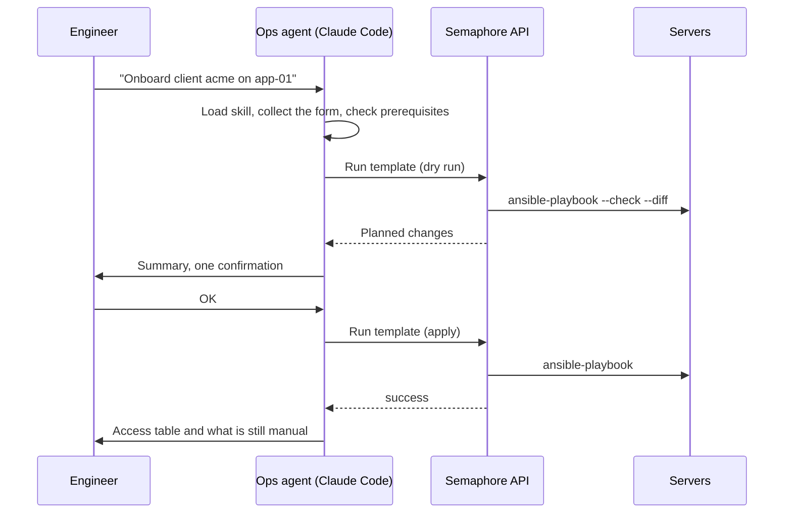

# AI-assisted operations

How I use **Claude Code** to operate Linux infrastructure: not as a chat window, but as an operator that runs real tasks through the same tools a human uses (Semaphore, SSH, the ticket system, the team chat), with guardrails.

## Building blocks

| Piece | File | Role |
|---|---|---|
| Operations agent | [`agents/ops-assistant.md`](agents/ops-assistant.md) | Receives a task in natural language and carries it to the end: connects to servers, collects reports, logs work in the ticket system, notifies the team |
| Skill | [`skills/semaphore-run`](skills/semaphore-run) | Teaches the agent to run Ansible through Semaphore's API: dry run, confirmation, apply, report |
| Scheduled routines | [`routines/routine.sh`](routines/routine.sh) | Turns "every weekday at 07:30, check X" into a systemd timer that runs the agent headless |
| Alert format | [`routines/alert-format.md`](routines/alert-format.md) | Every automated message starts with a traffic-light summary, so a person knows in one line whether to act |

## What changed in practice

- Repetitive operations (new client, VPN peer for a store terminal, SSH key for a terminal) went from a page of manual steps to one request. A teammate who does not know Ansible can run them.
- Recurring checks (disk, services, backups) run at night as **routines** and report in the morning with a single line saying whether anyone needs to act.
- A shared, Git-versioned **knowledge base** (runbooks, incidents, server map) is the first thing the agent reads, so it does not rediscover the same facts every session.

## Guardrails

These matter more than the prompts.

1. **Scripts write, the agent decides.** Skills call a small, reviewed script (`semaphore-run.sh`). The agent never improvises API calls or edits existing inventories and templates.
2. **Dry run first, one confirmation.** Changes are shown as a plan before they run.
3. **Unattended means read-only.** In a scheduled run nobody can answer questions, so the agent only reads, never restarts services, deletes data or deploys, and stops at the first unexpected result instead of improvising a workaround in production.
4. **Secrets stay out of the model.** Tokens come from environment files, passwords are generated on the server, and nothing secret goes into task parameters (they stay in Semaphore's history).
5. **No commits without a human.** The agent leaves changes in the working tree and asks. Deploys only happen through Git.
6. **Everything is auditable.** Semaphore keeps task history, routines keep one log per run, and the ticket system records the hours.
