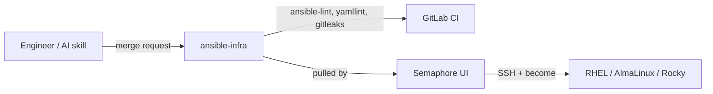

# ansible-infra


Ansible roles and playbooks to provision **hardened RHEL-family servers** running **rootless Docker** and to onboard client applications from a single variables file.
Designed to run from the command line or from [Semaphore UI](../semaphore-platform).

## Problem

New servers were configured by hand: SELinux disabled "to make it work", root SSH login, Docker running as root, and every client deployment slightly different. That meant slow onboarding, configuration drift and a large attack surface.

## Solution

| Role | What it does |
|---|---|
| `baseline` | Packages, security updates, **SELinux enforcing**, users with exclusive SSH keys, SSH hardening (validated with `sshd -t`), firewalld |
| `docker_rootless` | Docker CE in **rootless mode** for an unprivileged service user (lingering + systemd user service). The rootful daemon stays disabled |
| `app` | Clones the app at a pinned version, renders `.env`, logs in to the registry (secrets never logged), runs `docker compose up -d` as the service user |

| Playbook | Purpose |
|---|---|
| `playbooks/provision.yml` | New server: baseline + rootless Docker |
| `playbooks/onboard_client.yml` | New client: `-e client_file=vars/<client>.yml` |
| `playbooks/patch_pwnkit.yml` | Fleet-wide remediation of **CVE-2021-4034** with a compliance report |

## Architecture



## How to run

```bash
python3 -m venv .venv && source .venv/bin/activate
pip install ansible-core
ansible-galaxy collection install -r requirements.yml -p ./collections

# 1. Edit inventories/lab/hosts.yml and inventories/lab/group_vars/all.yml
# 2. Dry run first, always
ansible-playbook playbooks/provision.yml --check --diff
# 3. Apply
ansible-playbook playbooks/provision.yml

# Onboard a client
cp vars/client.example.yml vars/acme.yml
ansible-playbook playbooks/onboard_client.yml -e client_file=vars/acme.yml
```

**Supported:** RHEL / AlmaLinux / Rocky Linux 8 and 9.
Amazon Linux 2023 needs a different Docker repository (planned).

## Security decisions

- SELinux stays **enforcing**. Problems get fixed with proper contexts and booleans, never by disabling it.
- Containers run **rootless**, so a container escape lands in an unprivileged user, not root.
- Secrets come from Semaphore's key store or Ansible Vault. `no_log` protects registry tokens.
- Every merge request runs **gitleaks**, so no secret reaches the repository.

## Results (real-world use of this approach)

- New servers provisioned the same way every time, from a single Semaphore template.
- Client onboarding reduced to one variables file.
- Polkit CVE-2021-4034 patched across the fleet with an auditable report.

## Roadmap

- [ ] Molecule tests (AlmaLinux 9 container)
- [ ] `monitoring_agent` role (Zabbix agent 2)
- [ ] `postgres` role with SCRAM-SHA-256 and a hardened `pg_hba.conf`
- [ ] Amazon Linux 2023 support

---
Author: **Jean Lima**, DevOps Engineer · [LinkedIn](https://www.linkedin.com/in/jcmdl)
