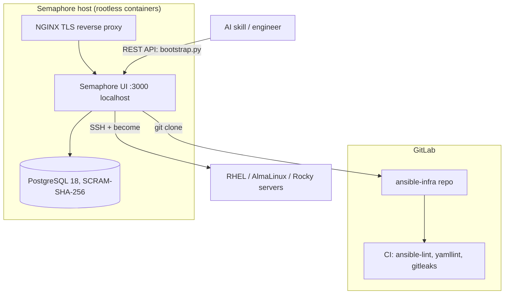

# Architecture

## Guardrails

1. **Dry run first:** every playbook has a `--check --diff` template, and that runs before the apply.
2. **Secrets stay in Semaphore's key store.** They are encrypted with `SEMAPHORE_ACCESS_KEY_ENCRYPTION` and never written to Git or passed to AI prompts.
3. **Semaphore binds to localhost.** Only the TLS reverse proxy is exposed.
4. **The containers run rootless** with `no-new-privileges`.
